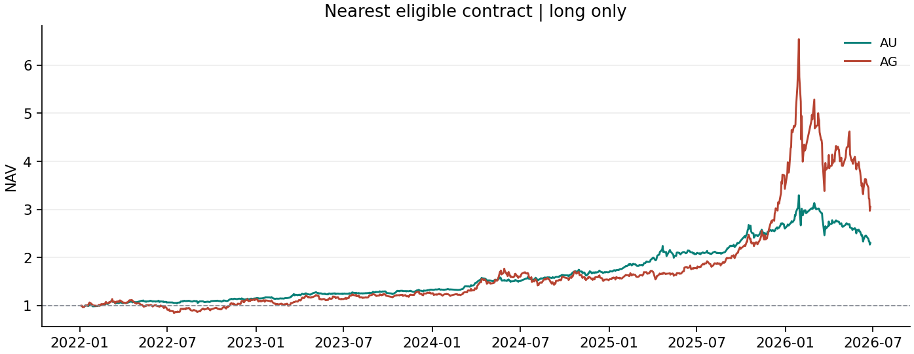
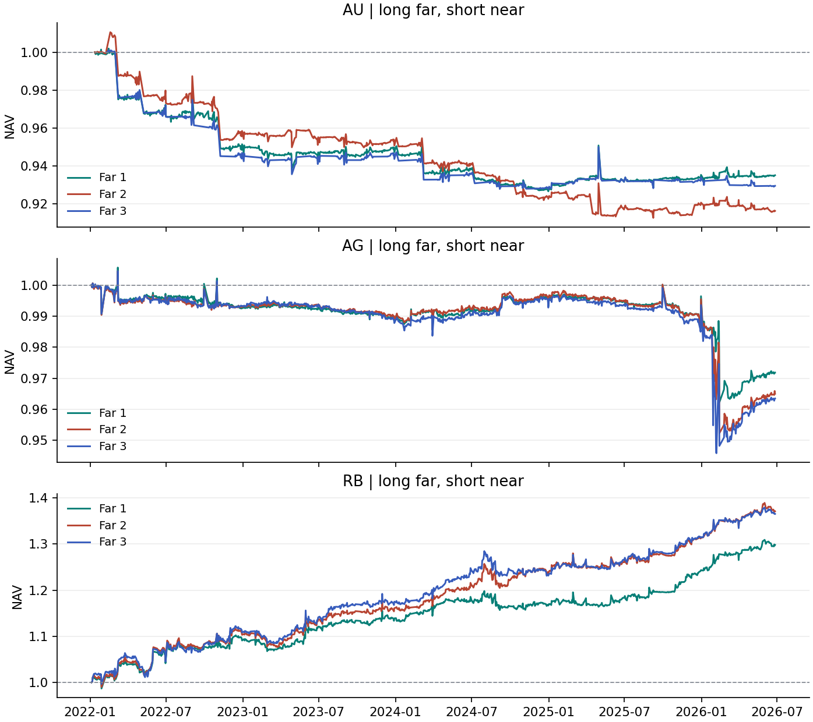
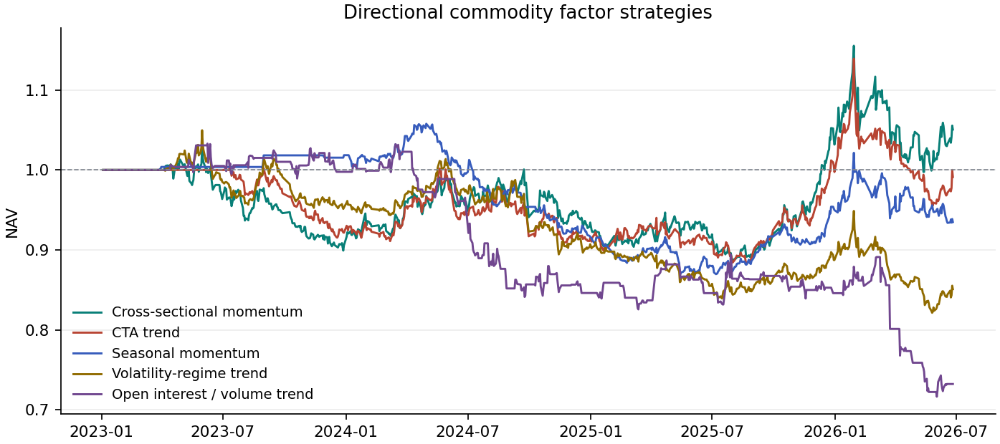

这项研究最初是为了回答一个基础问题：如果一直持有黄金期货，但不进入交割月末的到期窗口，净值应该怎么算？建立逐合约展期基准后，我把同一套框架扩展到 13 个国内商品，并问了一个更具体的问题：**远月经常比近月贵，做多远月、做空近月是否就能赚钱？** 在这段样本里，黄金和白银的答案都是否定的。

## 1. 从逐合约价格构建展期基准

通过 AkShare 获取合约信息和新浪逐合约日线。品种包括 AU、AG、CU、AL、ZN、RB、HC、I、M、Y、P、TA、MA。每个交易日持有距最后交易日超过 **5 个自然日**的最近可用合约；进入窗口后切到下一个合格合约。部分大商所合约的到期安排由日线推断，不等同于逐份核对官方最后交易日。

先在每个合约内部计算收盘到收盘收益，再按持仓规则选取收益。换仓日取新合约自身的日收益，不用新合约收盘价除以旧合约收盘价。这样不会把两个合约本来就存在的价差记作换仓利润，但仍是收盘到收盘的近似，并不代表能按该价格完成换仓。

2022 年至 2026 年 6 月的已保存回测中，AU 滚动多头累计 **+129.92%**，最大回撤 **−31.13%**；AG 累计 **+205.83%**，最大回撤 **−54.57%**。这是单品种名义多头收益，不是保证金账户收益；两者的有效观测数分别为 1,024 和 1,083。

## 2. Contango 不是收益方向

用同一天的远近月收盘价比较期限结构：当远月价高于近月价时记为 contango。近月与下一档远月的独立快照统计中，AG 和 AU 的 contango 比例分别为 **83.47%** 和 **83.29%**，RB 为 **62.33%**；HC 为 **49.22%**，I 则仅为 **13.54%**。快照统计与可计算策略收益的交易日不完全相同。

跨期策略对两条腿各配置 50% 的名义敞口，始终多远月、空近月。远端第 1、2、3 档分别指在合格近月之后的第 1、2、3 个可用到期合约，不保证固定相隔几个自然月。两条腿均遵守到期前 5 个自然日的筛选规则。

| 品种 | 远端第 1 档 | 远端第 2 档 | 远端第 3 档 |
| --- | ---: | ---: | ---: |
| AU | −6.49% | −8.37% | −7.05% |
| AG | −2.82% | −3.50% | −3.65% |
| RB | +29.82% | +37.10% | +36.53% |

表中是各自有效样本的累计收益。AU 三档分别有 1,024、917、483 个有效观测，不能把它们当成同一组交易日上的严格对照。

远月价格高于近月价格，只描述**同一天的曲线**。实际盈亏取决于**持有期间两条腿的收益差**：近月涨 2%、远月涨 1%，即便远月到收盘仍更贵，这组持仓当天也会亏约 0.5%。临近交割时，近月趋向的是届时的现货价格，不是开仓时的现货价。现货上涨时，近月完全可能一边收敛、一边上涨。把多头放得更远，也不会自动改变这个关系。

## 3. 把策略扩展到不稳定的期限结构

在 13 个品种上交叉比较三档远端合约、固定多价差、固定空价差和价差均值回归。均值回归用滞后一日的相对价差，在 252 个有效观测的滚动窗口中标准化（最少 126 个观测）；超过 +1 时做空价差，低于 −1 时做多价差，代码的平仓阈值设为 0，阈值之间延续持仓。这个信号针对的是价差相对自身历史的位置，不要求品种长期处于 contango。

例如，远端第 1 档的均值回归在 AU 样本内累计 **+15.96%**、最大回撤 **−2.29%**；期限结构更混合的 HC 累计 **+35.15%**、最大回撤 **−3.60%**。这说明“不持续 contango”不妨碍检验跨期策略，但这些结果来自同一段样本和多组筛选，不能据此认定存在可交易的超额收益。换约本身也会改变观测到的价差，下一步需要按合约对、到期距离和季节重新核对信号。

## 4. 同一展期框架上的方向性策略

另一个分支使用同一套滚动合约收益，测试截面动量、CTA 趋势、季节动量、波动状态过滤和持仓量／成交量确认。样本从 2023 年 1 月 3 日到 2026 年 6 月 26 日，与上面的价差结果不是同一实验。

| 策略 | 累计收益 | 最大回撤 |
| --- | ---: | ---: |
| 截面动量 | +5.06% | −13.74% |
| CTA 趋势 | −0.87% | −16.15% |
| 季节动量 | −6.51% | −17.79% |
| 波动状态趋势 | −14.91% | −21.77% |
| 持仓量／成交量确认趋势 | −26.79% | −30.66% |

## 5. 下一轮验证

上面的结果均是研究性回测，未扣手续费和滑点，也未建模保证金、涨跌停及远月成交约束。下一轮优先做三件事：统一远端档位的对比交易日；用逐腿换仓记录和可成交报价估计成本；冻结参数后做滚动样本外验证。在此之前，最可靠的结论是：**先验证收益来自哪里，再决定是否把期限结构当作交易信号。**
