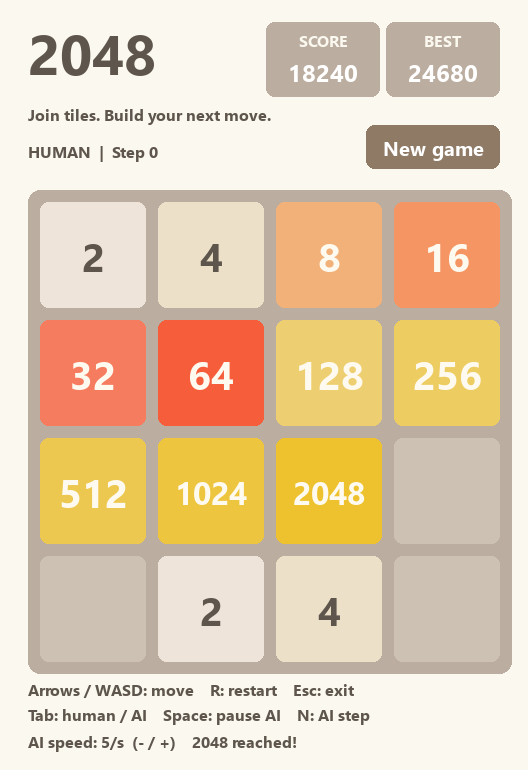
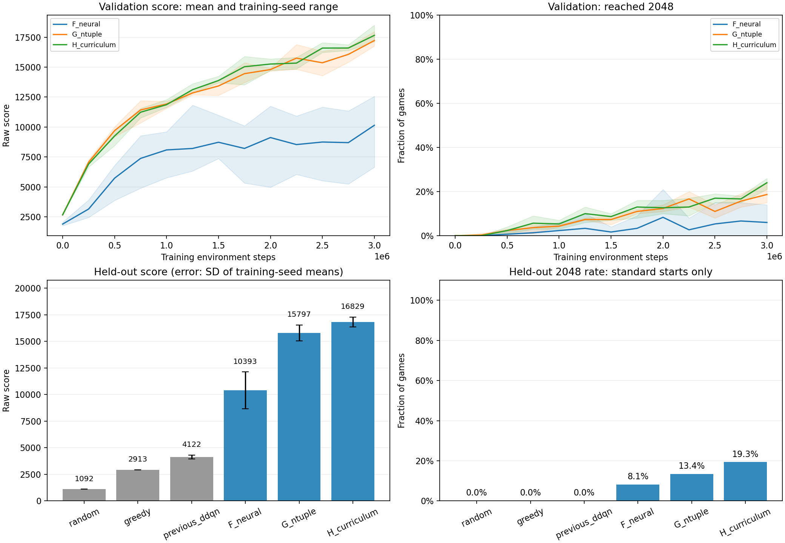
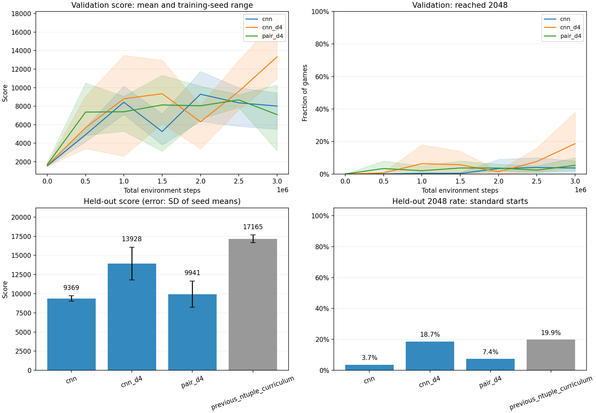

最初只是想做一个能在电脑上玩的 2048，后来又多了一个问题：能不能让模型自己玩、自己积累经验，逐渐学会合出更大的方块？于是，这个小项目从本地游戏扩展成了一套包含规则引擎、训练环境、模型播放和对照实验的强化学习实验平台。

目前完成了四轮实验。第四轮中，加入旋转和镜像平均的 **单输入 D4 CNN** 将三种子平均 2048 达成率从普通 CNN 的 **3.7% 提高到 18.7%**。同一套测试种子上，上一轮 n-tuple H 的平均分与达成率仍最高。按验证集选出的 D4 CNN 展示模型在独立测试中有 **87/300 局（29.0%）** 达到 2048。

[在 GitHub 查看源码与实验结果](https://github.com/Sputnik103/2048-reinforcement-learning){ .md-button .md-button--primary }



*本地 Pygame 界面的固定示例棋盘，用于展示布局与配色，不是模型实战成绩。*

## 一套规则，三种使用方式

项目用 Python 编写，规则引擎同时服务于真人游戏、智能体播放和 Gymnasium 训练环境，避免界面里的游戏与模型训练的游戏使用不同规则。

| 模块 | 已完成的功能 |
|---|---|
| 本地游戏 | Pygame 窗口、移动与合并动画、分数与最高分、重新开局 |
| 智能体播放 | 随机、即时得分贪心、Double DQN、afterstate 模型；暂停、单步与速度调节 |
| 训练环境 | Gymnasium 接口、合法动作掩码、固定随机种子、无窗口训练与评估 |
| 实验记录 | 参数与依赖版本、训练日志、验证检查点、独立测试与训练曲线 |

棋盘为 4×4，标准开局有两个随机方块。有效移动后，在空格中均匀选择位置，以 90% / 10% 的概率生成 2 / 4；无效移动不生成方块。奖励就是本次合并的得分，不额外加入空格数或大方块奖励。默认达到 2048 后继续游戏，直到没有合法动作。

## 第一轮：先建立 Double DQN 基线

第一版把棋盘中的方块转为 log₂ 编码，输入一个小型全连接网络，由网络预测四个方向的动作价值。训练加入合法动作掩码、经验回放和目标网络，并用 Double DQN 的方式选择和评估下一步动作。

三个训练种子各训练 20 万环境步，每个选定模型在独立测试集上跑 100 局。跨训练种子的平均分为 **2,769.05**，还没有稳定超过当时测试集上的即时得分贪心基线，也没有合出 2048。

这一步的收获是建立了可训练、可评估、可加载回游戏窗口的完整流程，而不是证明模型已经学会了游戏。

## 第二轮：更多训练与控制变量实验

第二轮将每个模型的训练预算增加到 100 万步，比较 log 编码、one-hot 编码、对称性增强及不同折扣因子。按验证成绩选中的方案仍使用 log 编码，不开启对称性增强，折扣因子为 0.995。

在这一轮独立测试中，选中方案的三种子平均分为 **4,199.51**，仍未达到 2048。与同为 100 万步、折扣因子为 0.99 的对照组相比，平均分约提升 **5.0%**。对旧版更大的提升同时包含训练预算与验证流程变化，不能全部归因于折扣因子。

前两轮让我意识到：单纯提高平均分，并不意味着模型已经学会突破中后盘。

## 第三轮：把已知规则交给环境，把局面价值交给模型

2048 的一次操作可以拆成两个阶段：

```text
当前棋盘 → 移动、合并并获得奖励 → afterstate → 随机生成新方块 → 下一棋盘
```

**afterstate 是合并完成、但随机新方块尚未生成的棋盘。** 既然移动与合并的规则完全已知，就可以先由规则引擎算出每个合法方向的结果，再让模型评估这些结果未来还能带来多少得分。

当前实现选择使 `本次合并得分 / 128 + γ × afterstate 价值` 最大的动作。价值函数不包含刚刚获得的奖励，避免重复计分；第三轮 γ 为 1。奖励除以 128 只是固定尺度变换，最终结果始终报告原始游戏分数。

这一轮比较了三个方案：

| 方案 | 方法 | 想回答的问题 |
|---|---|---|
| F | 神经网络 afterstate TD | 改变价值学习对象后，小型神经网络能否学得更好？ |
| G | n-tuple afterstate TD | 使用局部格子模式查表估值，是否更适合 2048？ |
| H | n-tuple + 后期局面训练 | 增加中后盘经验，能否提高正常开局的通关率？ |

n-tuple 用四组五格模式查询可训练权重，再将它们相加得到价值；旋转、镜像共享参数，共约 419 万个表格权重。它属于强化学习中的函数逼近方法，并不是深度神经网络。

H 在 F/G 验证比较后采用表现更好的 n-tuple 方法，从头训练。训练每次重开时有 25% 的概率从局面池开始，池中只保存训练时真实到达的 256、512、1024 局面。验证和测试全部使用标准开局，不从这些后期棋盘起步，也不把保存局面的历史分数记作新奖励。

## 第三轮独立测试

F/G/H 各训练三个种子（42、43、44），每个模型 300 万环境步。每 25 万步使用固定 100 局验证集，先按 2048 达成率、再按平均分选检查点。方法与代表模型的选择都在查看最终测试成绩前冻结。

最终每个模型使用同一套 300 个新游戏种子，从标准开局测试，同时复测上一轮三个 DQN 模型及随机、贪心基线。

| 方法 | 测试平均分 | 2048 达成率 | 达成次数 / 模型-游戏组合 |
|---|---:|---:|---:|
| 随机合法动作 | 1,091.97 | 0.0% | 0 / 300 |
| 即时得分贪心 | 2,912.68 | 0.0% | 0 / 300 |
| 上一轮 Double DQN | 4,122.16 | 0.0% | 0 / 900 |
| F：神经网络 afterstate | 10,392.96 | 8.1% | 73 / 900 |
| G：n-tuple afterstate | 15,797.31 | 13.4% | 121 / 900 |
| H：n-tuple + 后期局面训练 | **16,828.80** | **19.3%** | **174 / 900** |

三个模型共享 300 个游戏种子，因此每组 900 个模型-游戏组合不等于 900 个独立游戏种子。第二轮的 4,199.51 与这里 DQN 的 4,122.16 来自不同测试种子，不能混用。



*第三轮原始实验图。误差条表示三个训练种子平均分的标准差，不是置信区间。*

H 相比 G 的平均分提升约 **6.5%**，2048 达成率增加约 **5.9 个百分点**。但不是每个训练种子都改善，seed 43 略有退步。F 与 G 的表示、参数量和更新机制也不同，这是完整方法之间的对照，不能只归因于换了一种表示。旧 DQN 每个种子只训练 100 万步，与第三轮并非等预算消融。

## 第三轮代表模型与中后盘瓶颈

按验证集选出的展示模型是 H 的 seed 42、300 万步检查点。它在独立测试中平均得分 **17,475.41**，65/300 局达到 2048，最高分 **43,020**。这里的 21.7% 是单个模型成绩，19.3% 才是 H 三个训练种子的平均达成率。

H 组 900 次测试里，有 523 次最终最大方块停在 1024，没有出现 4096。模型已经比早期 DQN 更能维持棋盘结构，但中后盘依然是明显瓶颈。

第三轮全部 4,200 个测试组合均自然结束，没有步数截断。实验启动前通过了 45 项自动测试，最终核对了核心代码指纹、代表模型与选定检查点的一致性，并验证模型可在 Pygame 游戏循环中加载和选择动作。这些是该轮保存的验证记录。

## 为什么不能直接和论文的高达成率相比？

项目参考了 Szubert 与 Jaśkowski 的 [2014 年 afterstate / n-tuple TD 论文](https://mszubert.github.io/papers/Szubert_2014_CIG.pdf)，但当前实现不是逐项复现。尤其需要区分 **训练步数** 与 **完整游戏局数**：第三轮代表模型训练 300 万次移动，完成了 4,055 局正常游戏和 1,316 个重启片段，不能当作训练了 300 万局。

当前使用四组五格模式，并保留随机探索与自己的归一化权重更新方式。后续若与论文比较，应先对齐特征结构、训练策略、更新规则和完整游戏预算，再讨论达成率差异；现在不能把二成左右的成绩看作 n-tuple 方法的上限。

## 第四轮：用 GPU 比较卷积网络与棋盘对称性

这一轮继续用 afterstate 估计未来得分。普通 CNN 读取移动并合并后的棋盘。单输入 D4 CNN 对棋盘的八种旋转与镜像分别估值，再取平均。双输入 D4 CNN 还读取移动前的棋盘，两个棋盘一起旋转或镜像。

三组各用训练 seed 42、43、44，每个模型在 RTX 4070 Ti 上训练 300 万环境步。三组共享训练预算、回放比例和课程学习设置，按验证集达成率、再按平均分选取检查点。选型冻结后，每个模型用相同的 300 个新游戏种子从两个随机方块开局，同时复测上一轮的三个 n-tuple H 模型。全部 3,600 个模型与游戏的组合都自然结束。

| 模型组 | 独立测试平均分 | 2048 达成次数 | 达成率 |
|---|---:|---:|---:|
| 普通 CNN | 9,369.18 | 33 / 900 | 3.7% |
| 单输入 D4 CNN | 13,927.83 | 168 / 900 | 18.7% |
| 双输入 D4 CNN | 9,940.64 | 67 / 900 | 7.4% |
| 上一轮 n-tuple H，同种子复测 | 17,165.05 | 179 / 900 | 19.9% |

加入 D4 对称平均后，三个训练种子的平均分和达成率都提高了，组达成率增加 **15.0 个百分点**。在 D4 基础上额外输入移动前棋盘后，三个种子的两项指标都下降了。n-tuple H 在同种子复测中仍领先 CNN。它使用在线表格更新，CNN 使用经验回放，因此这部分是两种完整训练方案的比较。



*验证曲线阴影表示三个训练种子的范围。测试分数误差条表示三个种子平均分的标准差。*

### 看 D4 CNN 合出 2048

验证集选出的展示模型是单输入 D4 CNN 的 seed 43，在第 300 万步保存。该模型在独立测试中的平均分为 **16,048.85**，达成率为 **29.0%（87/300）**。同组三个模型的达成率分别为 3.0%、29.0% 和 24.0%，组平均为 18.7%。

下方是一局选出的成功回放，游戏 seed 为 9000109。模型从标准开局出发，在第 **986 步**首次合出 2048，当时得分 **20,492**。视频约 51 秒，最后 28 步放慢播放。

<video controls preload="metadata" playsinline width="528" height="770" style="display:block;max-width:100%;height:auto" poster="../assets/2048/cnn_replay_final.png">
  <source src="../assets/2048/cnn_replay.mp4" type="video/mp4">
</video>

[打开 MP4 回放](assets/2048/cnn_replay.mp4) · [查看合出 2048 时的棋盘](assets/2048/cnn_replay_final.png)

## 在本地运行

以下命令在已有项目源码目录中执行。游戏与训练依赖分开管理，训练和已训练模型播放需要 PyTorch；前三轮在 Windows CPU 环境运行，第四轮的 CNN 训练使用 CUDA。

```powershell
# 真人游玩
.\.venv\Scripts\python.exe -m rl2048

# 观看第三轮选定的模型
.\.venv\Scripts\python.exe -m rl2048 --agent afterstate --model runs/afterstate_v3/champion.pt

# 从头训练一个新的 n-tuple 模型，输出目录需不存在
.\.venv\Scripts\python.exe -m rl2048.train_afterstate --kind ntuple --output runs/ntuple_new --steps 3000000
```

方向键或 WASD 移动，R 重新开局，Tab 在真人与 AI 间切换；AI 模式下可用空格暂停、N 单步、加减号调整速度。

这篇页面展示项目过程与保存的结果，本地 Pygame 游戏和训练程序仍在电脑上运行，网页提供录制好的模型回放。

## 实验资料

- [第四轮完整实验报告](assets/2048/cnn-report.md)：逐模型结果与测试口径。
- [第三轮完整实验报告](assets/2048/afterstate-report.md)：逐模型结果、训练预算与评估口径。
- [查看原始训练曲线大图](assets/2048/afterstate_results.png)。

接下来最值得做的是建立与论文设置对齐的基线，按完整对局数记录更长的学习曲线，再单独验证后期局面训练和搜索的增益。这个阶段仍属于后续计划。
