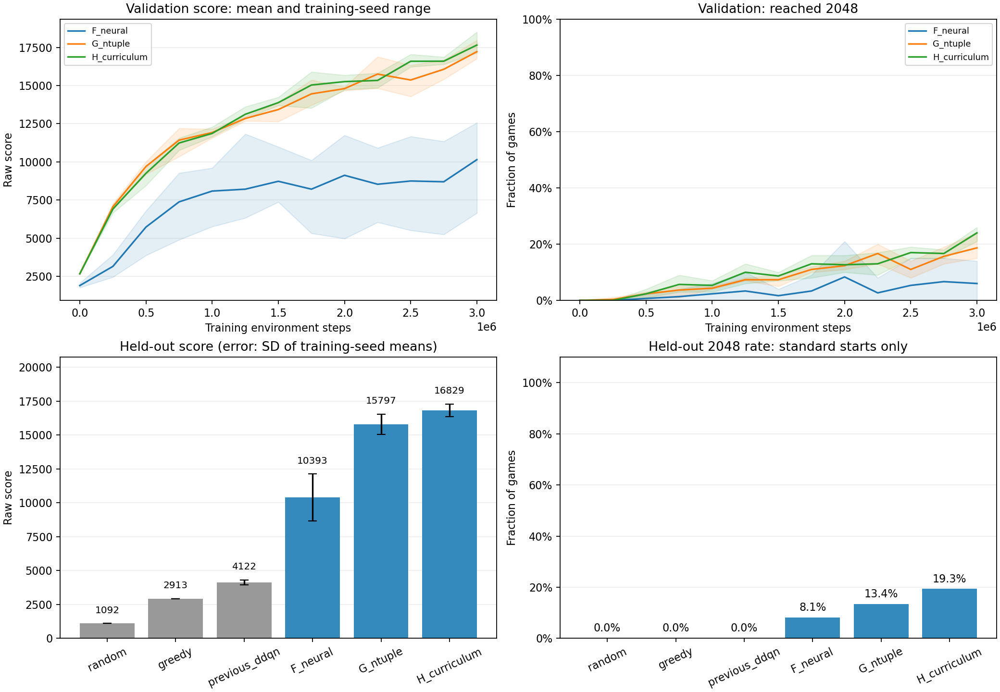

# F/G/H afterstate experiment

Validation-selected model: **H_curriculum**. Curriculum base: G_ntuple.

| Group | Validation 2048 rate | Validation score |
|---|---:|---:|
| F_neural | 12.3% | 11062.75 |
| G_ntuple | 21.0% | 17177.52 |
| H_curriculum | 24.0% | 17650.75 |

## Standard-start held-out evaluation

| Group | Mean score | 2048 rate | Model-game pairs | Truncated |
|---|---:|---:|---:|---:|
| F_neural | 10392.96 | 8.1% | 900 | 0 |
| G_ntuple | 15797.31 | 13.4% | 900 | 0 |
| H_curriculum | 16828.80 | 19.3% | 900 | 0 |
| greedy | 2912.68 | 0.0% | 300 | 0 |
| previous_ddqn | 4122.16 | 0.0% | 900 | 0 |
| random | 1091.97 | 0.0% | 300 | 0 |

All policies use the same held-out seed suite. No curriculum starts or training occur during evaluation.
Three policies evaluated on the same seeds are not three independent seed suites.
F uses neural replay/target networks; G uses online linear TD with tied local features. This compares methods, not only parameter counts.
No deep search, external demonstrations or reward shaping. Parameters, update counts, complete games, restart segments and elapsed time are recorded per run.

## Per-model held-out results

| Model | Checkpoint step | Mean score | 2048 reached |
|---|---:|---:|---:|
| F_neural_seed42 | 1250000 | 12090.61 | 28/300 (9.3%) |
| F_neural_seed43 | 2000000 | 11071.57 | 38/300 (12.7%) |
| F_neural_seed44 | 1000000 | 8016.71 | 7/300 (2.3%) |
| G_ntuple_seed42 | 2750000 | 15344.01 | 35/300 (11.7%) |
| G_ntuple_seed43 | 3000000 | 16858.60 | 55/300 (18.3%) |
| G_ntuple_seed44 | 2250000 | 15189.32 | 31/300 (10.3%) |
| H_curriculum_seed42 | 3000000 | 17475.41 | 65/300 (21.7%) |
| H_curriculum_seed43 | 3000000 | 16594.64 | 53/300 (17.7%) |
| H_curriculum_seed44 | 3000000 | 16416.33 | 56/300 (18.7%) |
| previous_ddqn_0 | 600000 | 3900.44 | 0/300 (0.0%) |
| previous_ddqn_1 | 800000 | 4117.27 | 0/300 (0.0%) |
| previous_ddqn_2 | 900000 | 4348.76 | 0/300 (0.0%) |

## Training budget and interpretation

All nine trials completed 3,000,000 environment steps each (27,000,000 total). Wall time including held-out evaluation: 62.6 minutes. Previous DDQN references had a 1,000,000-step budget per trial; the comparison to that version is not an equal-budget algorithm ablation.

| Trial | Parameters | Updates | Completed standard games | Completed restart segments | Seconds incl. validation |
|---|---:|---:|---:|---:|---:|
| F_neural_seed42 | 18817 | 749501 | 6855 | 0 | 2246.2 |
| F_neural_seed43 | 18817 | 749501 | 8092 | 0 | 2184.0 |
| F_neural_seed44 | 18817 | 749501 | 8467 | 0 | 2151.0 |
| G_ntuple_seed42 | 4194304 | 3000000 | 4820 | 0 | 1158.3 |
| G_ntuple_seed43 | 4194304 | 3000000 | 4744 | 0 | 1162.7 |
| G_ntuple_seed44 | 4194304 | 3000000 | 4761 | 0 | 1171.0 |
| H_curriculum_seed42 | 4194304 | 3000000 | 4055 | 1316 | 1368.1 |
| H_curriculum_seed43 | 4194304 | 3000000 | 3954 | 1291 | 1370.1 |
| H_curriculum_seed44 | 4194304 | 3000000 | 4073 | 1358 | 1367.6 |

H improved the group test mean score by 6.5% and the 2048 rate by 5.9 percentage points over G. Seed 43 was slightly worse with H; the gain is an aggregate result, not uniform across seeds. The plot error bars show SD across training-seed mean scores, not confidence intervals.

The representative checkpoint was selected using validation only: H_curriculum, seed 42, step 3,000,000. Its held-out mean score was 17,475.41, with 65/300 games reaching 2048 (21.7%) and a maximum score of 43,020. Champion identity was verified byte-for-byte against this checkpoint.

Of the 900 H model-game pairs, 523 ended with maximum tile 1024. None reached 4096. Validation-selected rates were higher than held-out rates; use a new held-out suite for future selection cycles.

All 4,200 evaluated model-game/baseline pairs used exactly seeds 5000000-5000299 and terminated naturally. All 14 source-manifest hashes matched the launch snapshot. The real champion loaded and selected an action in the Pygame event loop (dummy display). The implementation test suite passed 45 tests before the formal run.

